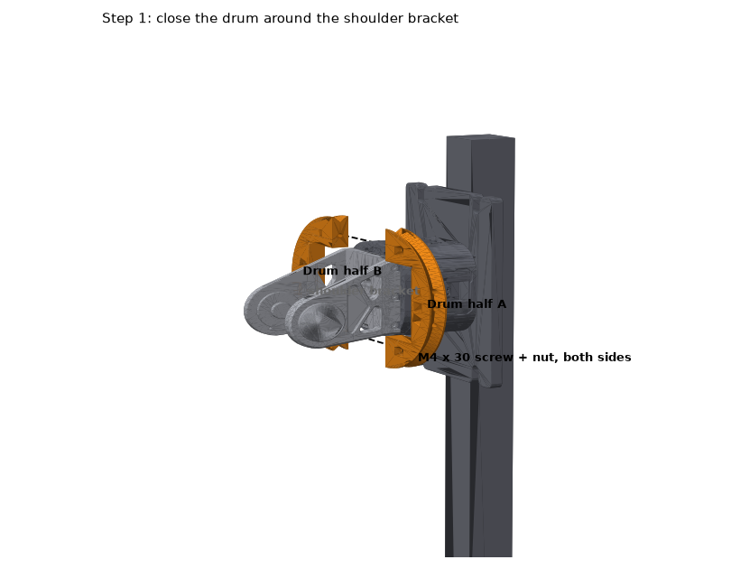
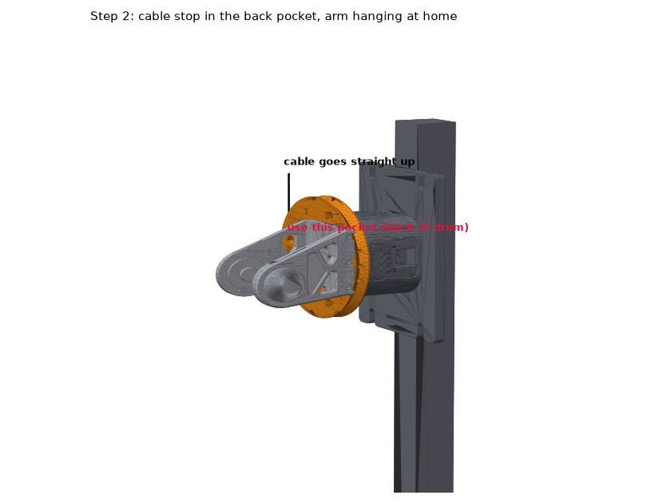
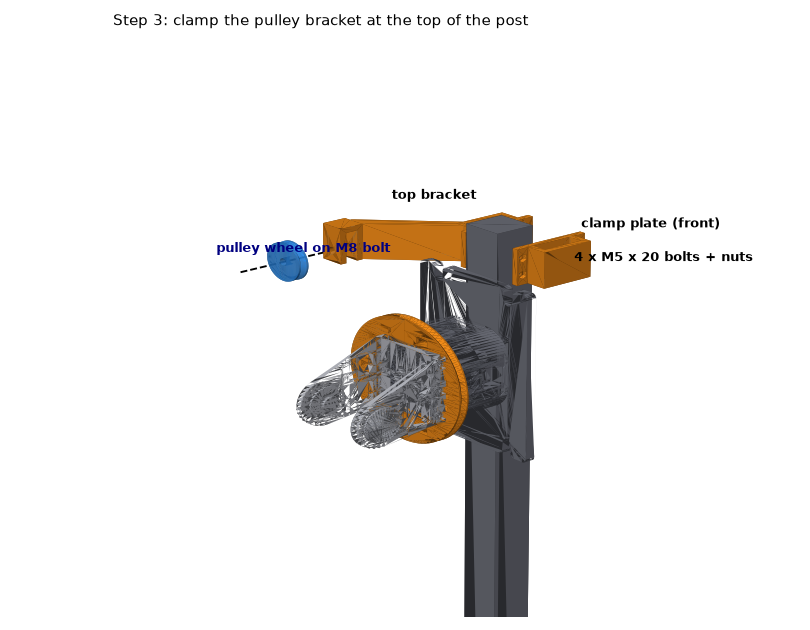
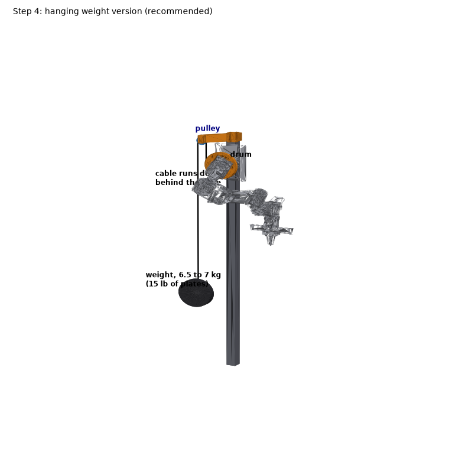
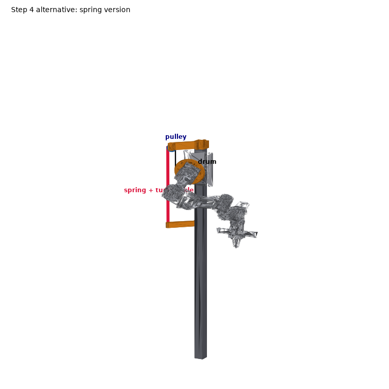

# Joint 1 counterbalance

The arms hang off the side of the post, so joint 1 holds the whole arm up whenever it reaches forward. Its RS06 can hold 8 Nm while still, and the ready pose alone asks 7.5 Nm. This kit takes part of that load off the motor. A printed drum clamps onto the shoulder bracket, a paracord wraps on it, runs up over a pulley at the top of the post and down behind the arm to a hanging weight (recommended) or a spring.


## Which version

| | Joint 1 at ready | Forward poses above 8 Nm | Joint 1 at home (hanging) |
|---|---|---|---|
| nothing | 7.5 Nm | about 40% | 0.1 Nm |
| hanging weight, 15 lb (6.8 kg) | about 3 Nm | about 10% | about 4.6 Nm |
| spring, 0.62 N/mm | 4.3 Nm | about 15 to 18% | 0.1 Nm |

All from the arm model, not measured yet. The weight wins: it pulls the same at every angle, which happens to match how the arm is used, it needs no spring hunting, and you tune it by adding or removing plates. Its costs: joint 1 holds about 4.6 Nm at home instead of nothing (still under its 8 Nm), and when an arm is powered off the weight swings it back about 25 degrees until gravity balances it, so support the arm before Power off.

## Check before printing

These numbers come from the reBot meshes and `rebot_teleop/config.py`. Measure them on the robot first; all of them are at the top of `make_parts.py`.

1. The post is 40 x 40 mm (`POST`).
2. The square base of the shoulder bracket (the U shaped part that joint 1 turns, right above the joint 1 motor) is 78 x 82.5 mm across its bottom 10 mm (`SQUARE_X`, `SQUARE_Y`).
3. There is at least 1.5 mm between the bottom of that bracket and the face of the joint 1 motor (`DRUM_Z`).
4. There are at least 42 mm of post between the top edge of the arm base plate and the top of the post (`COLLAR_H`), and nothing on the post top is in the way of a clamp.

To regenerate after changing a number: `pip install manifold3d trimesh` then `python make_parts.py`.

## Print (Bambu P1S, PETG, both arms in two plates)

Everything for both arms does not fit on one 256 mm plate: the two drums and the two brackets alone are more area than the bed. `print/paracord/counterbalance_paracord_both_arms_PETG_P1S.3mf` is one project with three plates, about 10.6 hours and 422 g of PETG in total:

| Plate | Parts | Time |
|---|---|---|
| 1 | right and left top brackets, two clamp plates, two pulley wheels | 5.7 h |
| 2 | drum for one arm (both halves) | 2.4 h |
| 3 | drum for the other arm (both halves) | 2.4 h |

Settings on every plate: Bambu PETG Basic, 0.24 mm layers, 4 walls, 25% gyroid, no brim, no support, textured PEI plate. The pulley wheel is the bearing free version that turns on the M8 bolt; `pulley_sheave_608.stl` takes a 608 skateboard bearing if you have one. The spring version also needs `spring_anchor_right.stl`, `spring_anchor_left.stl` and two `anchor_clamp_plate.stl`.


## Shopping list (paracord version, both arms)

| Item | Qty | Where | Cost (CAD) |
|---|---|---|---|
| [Everbilt 550 paracord, 50 ft](https://www.homedepot.ca/product/everbilt-diamond-braid-rope-550-paracord-medium-duty/1001927620), rated 110 lb | 1 | Home Depot, SKU 1001927620 | about $10 (estimate) |
| Paulin M5-0.8 x 20 mm hex cap screw + M5 hex nut | 8 each | Home Depot, Paulin metric drawer | about $6 (estimate) |
| Paulin M8-1.25 x 40 mm hex cap screw, M8 nylon lock nut, 2 M8 washers | 2 sets | Home Depot, Paulin metric drawer | about $4 (estimate) |
| Paulin M4-0.7 x 30 mm screw + M4 hex nut | 4 each | Home Depot, Paulin metric drawer | about $3 (estimate) |
| [Everbilt carabiner clip set](https://www.homedepot.ca/product/everbilt-eb-link-hook-carabiner-clip-set/1001846154) | 1 | Home Depot, SKU 1001846154 | about $4 |
| Weight, 6.8 kg per arm | 2 | see below | $0 to $76 |
| PETG for the three plates | 422 g | your spool | about $11 |

Weight options per arm, cheapest first: two 4 L jugs with 3.4 L of water each (free, and you tune by pouring); three bricks in a bag; a [10 lb cast iron plate](https://www.canadiantire.ca/en/pdp/wa-ke-athletic-1-in-cast-iron-weight-plate-single-assorted-weights-1842013p.html) ($24.99 at Canadian Tire) plus a 5 lb one.

Total with water jugs: about $27 of hardware plus about $11 of filament. With cast iron plates (5 lb plate estimated at $13): about $103 plus filament.

Spring version instead of weights, both arms: 2 extension springs of about 0.62 N/mm (3.5 lbf/in) that can stretch 190 mm, 2 [Everbilt eye and hook turnbuckles](https://homedepot.ca/product/everbilt-5-1-2-inch-zinc-eye-hook-turnbuckle/1000769521), 2 [Everbilt 1/4 x 2 in eye bolts](https://homedepot.ca/product/everbilt-1-4-inch-x-2-inch-eye-bolt-with-hex-nut-zinc-1-pc-/1000769927), and 8 more M5 screws and nuts.

## Assembly

Do this with the arm powered off and supported.

**Step 1. Drum.** Close the two drum halves around the square base of the shoulder bracket, slots facing outward away from the post. Drop an M4 nut in each nut slot, put the M4 x 30 screws through from the other half and tighten until the drum cannot move on the bracket. Turn the arm by hand: the drum must not touch the motor face below it.



**Step 2. Cord end.** Melt the cut ends of the paracord with a lighter so they cannot fray. With the arm hanging at home, find the three pockets on the drum's back side (towards the post side of the robot, away from where the arm reaches). Thread the cord out through the middle pocket's hole into the groove, and tie a figure eight knot on the end inside the pocket so it cannot pull through. From the groove the cord goes straight up.



**Step 3. Pulley bracket.** Put the M8 bolt through the bracket's fork with a washer, the pulley wheel, a washer, and the lock nut; snug, so the wheel still spins. Clamp the bracket around the post just under its top with the clamp plate on the front, four M5 x 20 screws with the nuts in their hex pockets. The fork sits out to the arm's side and behind the shoulder, straight above the back of the drum.



**Step 4. Weight.** Run the cord up into the front of the pulley groove, over the top and down the back. Tie a bowline to a carabiner about 30 cm above the floor with the arm hanging. Hang about two thirds of the weight first (one jug full, or the 10 lb plate), power the arm on and check the dashboard (below), then add the rest.



Spring version: instead of the weight, clamp the spring anchor lower on the post below the pulley and hang spring, turnbuckle and eye bolt from it. With the arm hanging, take up the turnbuckle until the cord is just taut.



## Tell the software

Add this to `~/.rebot-teleop/arms/right/settings.json` on the Jetson (keep any keys that are already there):

```json
{"counterbalance": {"constant_nm": 4.6, "forward": -1, "j2_min_deg": -20}}
```

and for the left arm, in `~/.rebot-teleop/arms/left/settings.json`:

```json
{"counterbalance": {"constant_nm": 4.6, "forward": 1, "j2_min_deg": -20}}
```

`constant_nm` is the weight in kg times 0.675 (the 68.8 mm cord radius on the drum times gravity): 4.6 for 6.8 kg, 3.1 for the 10 lb plate alone. For the spring version use `{"nm_per_rad": 3.0, "zero_deg": 90, "forward": -1, "max_deg": 170, "j2_min_deg": -20}` on the right and `zero_deg` -90, `forward` 1 on the left.

Restart the `rebot` service with both arms powered off. The gravity model then includes the counterbalance, so the budget timers, the sequence check and the feedforward stay right, and joint 2 is kept above -20 degrees where the upper arm would hit the drum. Check on the Home tab: at the ready pose the measured Nm on joint 1 should sit near the grav column, about 3 Nm, and at home about 4.6 Nm the other way.

## Quick test without printing

To feel the difference before printing: tie 550 paracord twice around the shoulder bracket just above its square base (below the joint 2 motor), lead it up over an Everbilt 1-1/2 in swivel pulley tied to the post top, and hang about 9 kg (four bricks or 20 lb of plates) behind. The square bracket is about 45 mm in radius, so it takes more weight than the drum. Tape the cord so it cannot ride up, support the arm whenever it is powered off, and keep the weight low.

## Things to watch

* All clearances are checked against the arm model only: the drum sits 2 mm above the joint 1 motor and the cord passes 22 mm from the motor housing. Check both by hand before powering on.
* The weight falls if the cord or a knot lets go: keep it within 30 cm of the floor.
* Keep fingers out of the drum and the pulley when the arm moves.
* Look at the cord where it runs over the pulley after the first week. Fuzz or a flat spot means replace it; it is a $10 part.

## Swapping joint 1 to a bigger motor later

The motor library on the Jetson already drives the RobStride RS03, and the server takes a per joint motor setting. From the RS03 manual:

| | RS06 (now) | RS03 |
|---|---|---|
| Holds while still | 8 Nm | 15 Nm |
| 20 Nm while still | 11 s | 30 s |
| Peak | 36 Nm | 60 Nm |
| Size | 88 mm across, 49 mm deep | 98 mm across, 54 mm deep |
| Weight | 621 g | 880 g |

It does not bolt in: its housing and output flange have different bolt circles, so it needs two aluminium adapter plates. Set the new motor to CAN ID 1 with host ID 0xFD, set its zero, then add `"motors": {"1": "rs-03"}` to that arm's `settings.json`.
