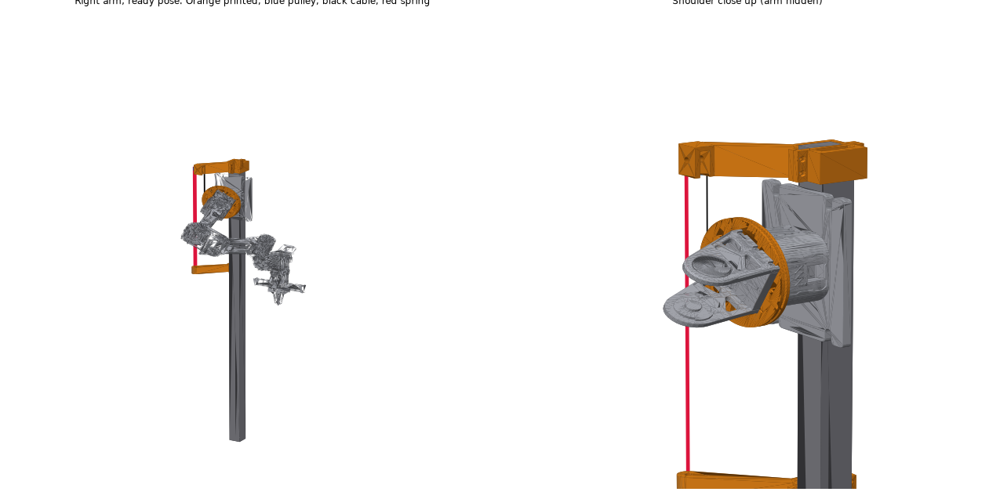
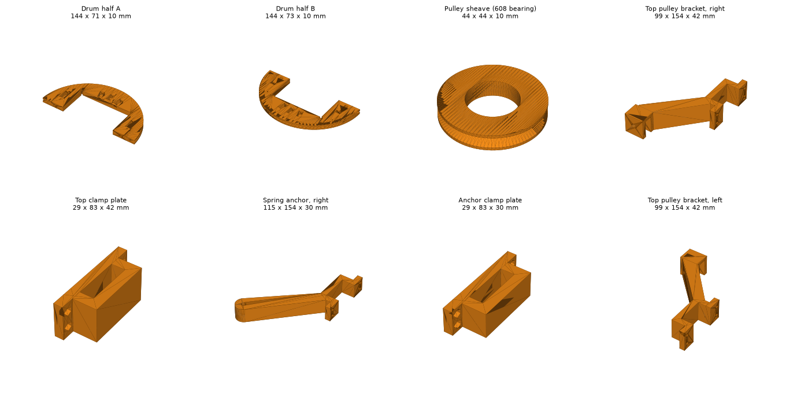

# Joint 1 spring counterbalance

The arms hang off the side of the post, so joint 1 holds the whole arm up whenever it reaches forward. Its RS06 can hold 8 Nm while still, and the ready pose alone asks 7.5 Nm. This kit adds a spring that carries part of that load. A printed drum clamps onto the shoulder bracket, a steel cable wraps on it, runs up over a pulley at the top of the post and down to a spring behind the arm. The spring only pulls when the arm swings forward from hanging, so the hanging home pose is unchanged.



## What it buys (arm model, not yet measured on the robot)

| Spring strength | Joint 1 at ready | Forward poses above 8 Nm |
|---|---|---|
| none | 7.5 Nm | about 40% |
| 3 Nm per radian (recommended) | 4.3 Nm | about 15 to 18% |
| 4 Nm per radian | 3.2 Nm | about 10 to 19% |

3 Nm per radian is the safe choice: stronger springs start pushing the arm up when it points high.

## Check before printing

These numbers come from the reBot meshes and `rebot_teleop/config.py`. Measure them on the robot first; all of them are at the top of `make_parts.py`.

1. The post is 40 x 40 mm (`POST`).
2. The square base of the shoulder bracket (the U shaped part that joint 1 turns, right above the joint 1 motor) is 78 x 82.5 mm across its bottom 10 mm (`SQUARE_X`, `SQUARE_Y`).
3. There is at least 1.5 mm between the bottom of that bracket and the face of the joint 1 motor (`DRUM_Z`).
4. There are at least 45 mm of post between the top edge of the arm base plate and the top of the post (`COLLAR_H`), and nothing on the post top is in the way of a clamp.

To regenerate after changing a number: `pip install manifold3d trimesh` then `python make_parts.py`.

## Print (PETG, or PLA+ if that is what you have)

| Part | Per arm | Notes |
|---|---|---|
| `drum_half_a.stl`, `drum_half_b.stl` | 1 each | flat, as exported. 6 walls, 40% gyroid |
| `pulley_sheave_608.stl` | 1 | flat. The 608 bearing presses in |
| `top_bracket_right.stl` or `top_bracket_left.stl` | 1 | flat on its bottom face. 6 walls, 50% infill |
| `top_clamp_plate.stl` | 1 | flat |
| `spring_anchor_right.stl` or `spring_anchor_left.stl` | 1 | flat. 6 walls, 50% infill |
| `anchor_clamp_plate.stl` | 1 | flat |

The left parts are mirror images of the right ones. The drum and the clamp plates are the same for both arms.



## Hardware store list (Home Depot or Canadian Tire), both arms

* 1/16 in (1.6 mm) steel wire rope, about 2 m
* 1/16 in aluminium ferrules (crimp sleeves) and stops, about 6, or 4 small 1/16 in wire rope clips
* 2 extension springs, see below
* 2 turnbuckles, 1/4 in or M6, hook and eye
* 2 eye bolts, 1/4 in x 2 in with nuts
* 2 608 bearings (skateboard bearings)
* 2 M8 x 40 bolts, 2 M8 nylon lock nuts, 4 M8 washers
* 4 M4 x 30 socket head screws and 4 M4 nuts (drum)
* 16 M5 x 20 screws and 16 M5 nuts (the four post clamps)
* a luggage scale for tuning

### The spring

Aim for 0.7 N per mm (4 lbf per inch) that can stretch at least 180 mm (7 in) without taking a set. A pull of about 70 N (16 lbf) after 100 mm (4 in) of stretch is right. Two lighter springs side by side work too, and so does a loop of 1/4 in shock cord if no spring fits; shock cord creeps, so retune it after a day.

Pull the cable takes at each forward swing from hanging, with the recommended strength:

| Swing forward from hanging | 30 deg | 60 deg | 90 deg (level) | 120 deg | 150 deg |
|---|---|---|---|---|---|
| Spring pull | 24 N (5 lbf) | 48 N (11 lbf) | 72 N (16 lbf) | 95 N (21 lbf) | 119 N (27 lbf) |

## Assembly

Do this with the arm powered off and supported.

1. Close the two drum halves around the square base of the shoulder bracket. The bolt slots face outward, away from the post. Drop the M4 nuts into their slots, tighten the M4 screws until the drum cannot turn on the bracket, and spin the arm by hand: the drum must not touch the motor face.
2. Press the 608 bearing into the sheave. Clamp the top bracket around the post just under its top with the clamp plate on the front, pulley fork out to the arm side and behind the shoulder. Put the sheave in the fork on the M8 bolt with a washer on each side.
3. Clamp the spring anchor lower down the same side of the post, under the pulley. How low depends on the spring: the spring, turnbuckle and eye bolt have to fit between them with the turnbuckle half open.
4. Crimp a stop on one end of the cable. With the arm hanging at home, seat the stop in the drum pocket that is at the back of the drum (towards the post side, three pockets sit there; use the middle one). Lead the cable along the groove to the back of the drum, straight up to the front of the sheave, over it and down to the spring. Spring to turnbuckle to eye bolt.
5. With the arm hanging, take up the turnbuckle until the cable is just taut, about 5 N (1 lbf) on the luggage scale.
6. Swing the arm forward by hand until the upper arm is level. The spring should now pull about 72 N. Tighten or loosen the turnbuckle, or change springs, to get close.

## Tell the software

Add this to `~/.rebot-teleop/arms/right/settings.json` on the Jetson (keep any keys that are already there):

```json
{"counterbalance": {"nm_per_rad": 3.0, "zero_deg": 90, "forward": -1, "max_deg": 170, "j2_min_deg": -20}}
```

and for the left arm, in `~/.rebot-teleop/arms/left/settings.json`:

```json
{"counterbalance": {"nm_per_rad": 3.0, "zero_deg": -90, "forward": 1, "max_deg": 170, "j2_min_deg": -20}}
```

Restart the `rebot` service with both arms powered off. The gravity model then subtracts the spring, so the budget timers, the sequence check and the feedforward stay right, and joint 2 is kept above -20 degrees where the upper arm would hit the drum. Check it on the Home tab: at the ready pose the measured Nm on joint 1 should sit near the grav column, around 4 Nm instead of 7.5. If it is off, change `nm_per_rad` to match.

## Things to watch

* All of this is checked against the arm model only. The drum sits 2 to 4 mm above the joint 1 motor and the cable passes 19 mm from the motor housing in the model. Check both by hand before powering on.
* Keep fingers out of the drum and the pulley when the arm moves.
* Look at the cable after the first day. A fraying strand means replace it.

## Swapping joint 1 to a bigger motor

The motor library on the Jetson already drives the RobStride RS03, and the server now takes a per joint motor setting. From the RS03 manual:

| | RS06 (now) | RS03 |
|---|---|---|
| Holds while still | 8 Nm | 15 Nm |
| 20 Nm while still | 11 s | 30 s |
| Peak | 36 Nm | 60 Nm |
| Size | 88 mm across, 49 mm deep | 98 mm across, 54 mm deep |
| Weight | 621 g | 880 g |

With an RS03 on joint 1, nearly every forward pose (worst case 16.6 Nm, 9 to 13 Nm usually) stays under its still rating, even without the spring. It does not bolt in: its housing and output flange have different bolt circles, so it needs one plate between its housing and the arm base and one between its output and the shoulder bracket, and the arm sits 5 mm further out. Those two plates carry the full joint torque, so have them cut from 6 mm aluminium rather than printed. Set the new motor to CAN ID 1 with host ID 0xFD, set its zero, then add `"motors": {"1": "rs-03"}` to that arm's `settings.json`.
