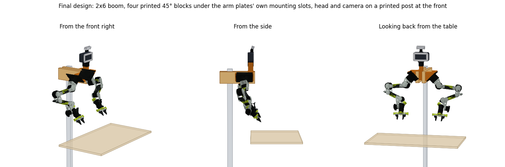
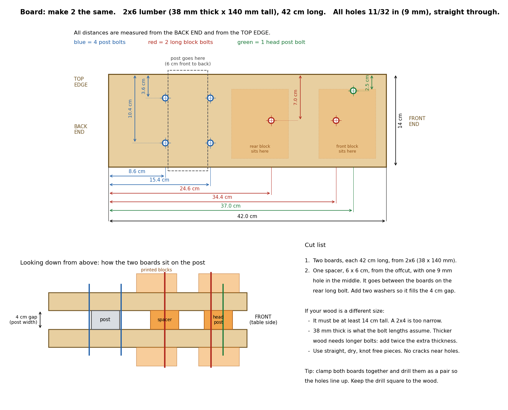
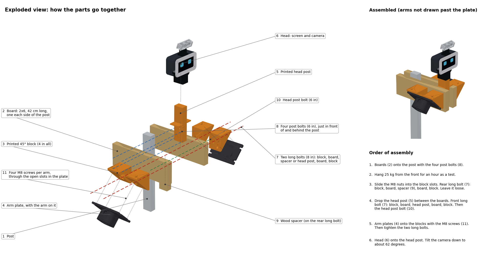

# Building the final mount

Two 2x6 boards run forward either side of the post and are bolted together so they squeeze it. Four printed 45 degree blocks bolt to the outside of the boards, two per arm, and each arm plate bolts to its two blocks through the plate's own mounting slots. The head, with its screen and camera, moves from the top of the post to a printed post at the front of the boards. No counterweight, pulley or cord.

## Will printed PETG hold the arms?

Yes for the blocks, no for the boom.

| Part | Load in the worst case (a motor pushing at its 36 Nm limit) | What the material takes | Verdict |
|---|---|---|---|
| Block, face under the arm plate | 0.1 MPa | PETG yields at about 50 MPa and slowly creeps above about 8 MPa | fine |
| Block, under each arm screw nut | 3 MPa from the arm, more from tightening | same | fine if the nuts are snug, not cranked |
| Block, under each fender washer | 0.6 MPa from the arm, about 4 MPa with the bolts tight | same | fine |
| Head post | 0.2 MPa | same | fine |
| 2x6 boards at the post | 0.4 MPa | spruce is allowed about 6 MPa | more than ten times spare |
| A printed boom instead of the boards | low on paper, but it would be joined from pieces because the printer bed is 256 mm and the boom is 420 mm | joints between pieces and between layers are the weak spots, and PETG slowly sags under a load that never lets go | do not print the boom |

The rule: plastic only where it is squeezed between metal and wood, never as a beam, and every bolt goes through to a nut. Wood carries the reach. Each arm weighs 6 kg.

## Sizes, and where they come from

| What | Size | Source |
|---|---|---|
| Arm plate | 140 x 200 mm, 10 mm thick | arm CAD, thickness confirmed by the operator |
| Arm plate mounting slots | four open slots 10.6 mm wide at the two short ends, centres 90 mm apart across the plate and 170 mm apart along it | arm CAD |
| The four round holes on a 68 mm square in the plate | countersunk for the small screws that hold the plate to the motor. Not for mounting | arm CAD |
| Space above the slots for a screw head and wrench | free | arm CAD |
| Post | 40 mm wide, 60 mm front to back | operator |
| Head collar pocket | 41 x 61 mm, 45 mm deep; the head slips over the post top | head CAD, confirmed by the operator |

Still to check on the robot, because CAD cannot tell:

1. That today's M8 bolts do sit in those four open slots.
2. How high the lift can raise the post. The arm plates should be centred about 72 cm above the table top. If the lift cannot reach, use a lower table.
3. The base board: its front edge should be at least 30 cm ahead of the post, or the base needs more weight at the back.
4. Whether the camera cradle can tilt to about 62 degrees down (today 45).

## Shopping list (prices approximate, CAD)

| Item | Qty | Use | About |
|---|---|---|---|
| 2x6 spruce, straight and dry, at least 1 m | 1 | two 42 cm boards and one small spacer. The store will cut it | $10 |
| 5/16 in x 6 in hex bolt | 5 | four squeeze the boards onto the post, one holds the head post | $2 each |
| 5/16 in x 8 in hex bolt | 2 | each goes through a block, both boards and the block on the other side | $3 each |
| 5/16 in nylon insert lock nut | 8 | every long bolt, one spare | $0.50 each |
| 5/16 in x 1 1/4 in fender washer | 16 | under every long bolt head and nut | $0.40 each |
| M8 x 40 hex cap screw (SKU 1000135048) | 8 | arm plates to blocks through the plate slots. Today's screws may fit | $1.17 each |
| M8 flat washer (SKU 1000128557) | 8 | under those screw heads, because the slots are open | $0.22 each |
| M8 nylon insert lock nut (SKU 1000128541) | 8 | in the block slots | $0.66 each |
| 11/32 in drill bit | 1 | all holes | $8 |
| PETG | 1.14 kg, 1.31 kg with the drill guide | see below | about $35 |

About $65 of hardware and wood plus the filament. Tools: a drill, two 1/2 in or 13 mm wrenches, a tape measure, a pencil and two clamps.

## Print

All PETG, 0.24 mm layers, 25% gyroid, no support. The files are already turned the right way up for the bed: import them and do not rotate or auto orient them. Weights and times are from the slicer.

| File | Qty | How | Plastic | Time |
|---|---|---|---|---|
| `stl/block_a_print_twice.stl` | 2 | stands on one triangular end, 5 walls | 227 g each | 6 h each |
| `stl/block_b_print_twice.stl` | 2 | the mirror image of block A, same settings | 227 g each | 6 h each |
| `stl/head_post.stl` | 1 | lies on its side so the bolt holes are level, 4 walls | 233 g | 6.6 h |
| `stl/drill_guide.stl` | 1, optional | lies flat. Hooks over the top edge of a board and marks every hole. 3 walls | 167 g | 4.5 h |

To change a number: `pip install manifold3d trimesh`, edit the top of `make_parts.py`, then `python make_parts.py`.

Sliced for the P1S on 2026-11-12 with Bambu Studio 2.9.1 on the amarsbar PC, in `~/jetson-work/mount_options_print/ready_to_print/`: `blocks_A_and_B_print_twice.3mf` (12.1 h, 453 g, print it twice), `head_post_print_once.3mf` (6.6 h, 233 g) and `drill_guide_optional.3mf` (4.5 h, 167 g). PETG Basic, textured PEI plate at 70 C, nozzle 255 C.

Slicing from the command line needs complete profiles. Loading the system P1S and PETG profile files directly gave a file marked PLA with a 45 C bed and no weight, because the command line does not follow their `inherits` and `include` entries. `flatten.py` in that folder builds complete profiles first. The counterbalance plates sliced on 2026-11-11 have that fault and must be sliced again before printing.

## Build

Do all of it with the arms powered off. Two people, or rest each arm on a chair, when moving the arms.

1. Cut two boards 42 cm long. On each, measured from the back end, mark the post line at 12 cm and the arm line at 29.5 cm.
2. Clamp the drill guide on a board with its notch on the arm line. Drill the two holes in the middle row (the long block bolts) and the single hole near the top front (the head post bolt). Move the guide so its notch is on the post line and drill the four corner holes (the post bolts). Do the same on the other board. Without the guide: block holes at mid height, 24.6 cm and 34.4 cm from the back end; head post hole 37 cm from the back end and 2.5 cm down from the top edge; post holes 3.4 cm either side of the post line, 3.6 cm and 10.4 cm down from the top edge.
3. Hold the boards either side of the post, level, with the arm plates' future centre about 72 cm above the table, and fit the four 6 in bolts with a fender washer each side. The bolts sit just in front of and just behind the post, so the boom cannot tip down even if the squeeze relaxes. Tighten until the boards cannot move on the post.
4. Test before anything else goes on: hang 25 kg (two full 10 L water jugs and a bit) from the front of the boom for an hour. Nothing may slip, crack or tip. If the base lifts at the back, add weight behind the post until it does not.
5. Slide an M8 lock nut into each of the two slots of every block: one from the top, one from the back.
6. Blocks go on the outside of the boards with the sloped face looking outward and down and the round washer pocket towards the arm line. Block A fits front left and rear right, block B front right and rear left (left and right as the robot sees them). Rear long bolt: through block, board, a 40 mm spacer cut from the board offcut, board, block. Front long bolt: the same, but the head post stands between the boards instead of the spacer, so drop the head post in first until its cap sits on top of the boards. A fender washer and lock nut go in each round pocket. Leave these two bolts just loose.
7. Fit the 6 in bolt through the head post's upper hole.
8. Lift an arm plate against its two blocks with the long side of the plate running front to back, and fit four M8 x 40 screws with washers through the plate's open slots into the block nuts. Snug plus a quarter turn. Do the other arm, then tighten the two long bolts.
9. Move the head from the top of the post onto the head post, screen facing forward, and tilt the camera to about 62 degrees down.
10. Tie a loop of paracord from each arm's shoulder bracket over the boards as a safety leash, slack enough not to carry load.
11. Check every nut again after one day and after one week. Wood and PETG both settle.

## Tell the software

With the arms off, stop the `rebot` service, copy `~/.rebot-teleop-sim-option-c/layout.json` to `~/.rebot-teleop/layout.json` and start the service again. That file sets where the arm bases are, the home and ready poses, where the head and its camera are, and how far to pull the hand in when a motor tires. Without it the software assumes today's mount. The layout support is in the working tree, not yet committed.

Then measure and set the table: its height and the distance from the post to its near edge, on the dashboard or in `table.json`. Check the camera by putting an object at a known spot on the table and reading it back with `locate`; adjust `head_pose` in `layout.json` until it agrees.

## What this changes elsewhere

1. **What the camera sees.** It looks down from about 1.76 m at the front of the boom and sees the table from about 30 cm in front of the post outward, about 75 cm to each side. It cannot see the strip under and behind the head.
2. **The post and base carry a forward load all the time**, about 20 to 50 Nm. A desk lift column has some play, so expect the hands to sag a few millimetres and wobble a little more than today. Step 4 is the check.
3. **Resting.** The arms cannot hang straight down any more because the table is underneath. The home pose is folded over the table and costs about 4 Nm, which the motors hold forever. Support the arms before Power off; they will fold down onto the table.
4. **Joint 1 works near the middle of its range** (about -65 to -5 degrees on the right arm) instead of near one end.
5. **Saved sequences and poses** are joint angles for today's mount. They must be recorded again.
6. **Limits.** Keep joint 2 at or under 180 degrees and the elbow under 178, as learned on 2026-11-11.
