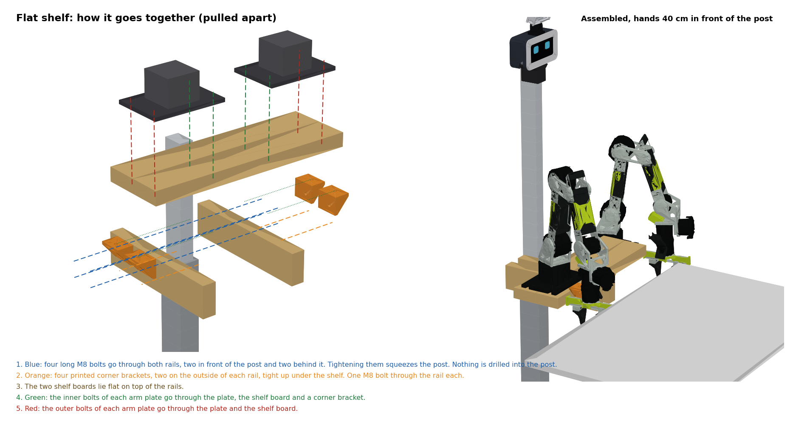
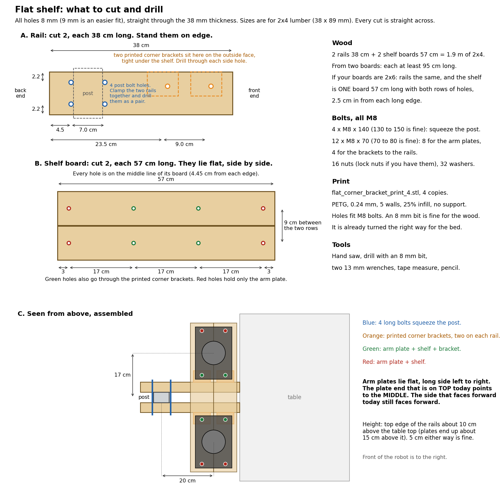

# Building the flat shelf

The arms sit upright on a level shelf, the way the maker intends, 20 cm in front of the post. Chosen by the operator on 2026-11-12 over the tilted boom in [BUILD.md](BUILD.md). The head and camera stay on top of the post.

## Why the shelf is forward of the post

Scored with the arm model on the same 60 hand positions as the other mounts. Not measured on the robot.

| | Today | Flat shelf level with the post | Flat shelf 20 cm forward (this build) |
|---|---|---|---|
| Hand positions reached, of 60 | 42 | 40 | 49 |
| Held forever, empty hand | 14 | 10 | 28 |
| Held forever with 0.5 kg | 8 | not run | 23 |
| Held forever with 1 kg | 3 | 0 | 17 |
| Shortest hold with 1 kg | 8 s | 8 s | 13 s |
| Worst shoulder load with 1 kg | 21.8 Nm | 21.9 Nm | 18.4 Nm |

Turning the arms flat does nothing on its own. All of the gain comes from the shoulders being 20 cm closer to the work. Today's sideways mount scores the same as this build (52 reached, 30 and 16 held forever) if the work is simply brought 20 cm closer to the post.

## Parts

| Part | Qty | Size |
|---|---|---|
| Rail, 2x4 on edge | 2 | 38 cm |
| Shelf board, 2x4 lying flat | 2 | 57 cm. With 2x6 wood use one board instead, both rows of holes 2.5 cm in from the long edges |
| Printed corner bracket `stl/flat_corner_bracket_print_4.stl` | 4 | 64 x 44 x 50 mm, PETG, 0.24 mm layers, 5 walls, 25% infill, no support. About 50 g and 1 to 1.5 hours each by estimate, not sliced yet. Holes are 8.6 mm for M8 bolts |
| M8 x 140 bolt (130 to 150 works) | 4 | squeeze the rails onto the post |
| M8 x 70 bolt (60 to 80 works) | 12 | 8 for the arm plates, 4 for the brackets to the rails |
| M8 nut, lock nuts if possible | 16 | |
| M8 washer | 32 | one under every head and every nut |

Total wood 1.9 m of 2x4. From two boards, each must be at least 95 cm long. Tools: hand saw, drill with an 8 mm bit (9 mm or 11/32 in gives an easier fit), two 13 mm wrenches, tape measure, pencil.

All four brackets are the same print. Each is a plain corner bracket with one hole up into the shelf and one hole sideways into the rail. The side hole is 1 cm off centre, so the bolts coming through the two rails miss each other in the gap between them.

## Will it slide down the post?

No corner brackets are needed for that. The two rails squeeze the post between them with four bolts, the same way the two arm plates squeeze it today. By estimate the grip holds about twenty times the weight of both arms.

Two cheap backups:

1. Set the rails so their bottom edge rests on top of the thicker lower part of the post. Then they cannot go lower. Never run the lift down past that point.
2. Draw a pencil line on the post under the rails. If the line ever shows, tighten the four long bolts.

The printed corner brackets are for a different job: they join the flat shelf boards to the rails so that every hole is a short straight hole and every small bolt is the same length. The shelf boards rest on the wood of the rails, so the brackets only stop the shelf lifting or shifting.

## Build

Arms powered off for all of it. Two people, or rest each arm on a chair, when moving the arms.

1. Print four corner brackets.
2. Cut two rails 38 cm and two shelf boards 57 cm.
3. Clamp the two rails together and drill the four post holes through both: 4.5 cm and 11.5 cm from the back end, 2.2 cm from the top edge and 2.2 cm from the bottom edge.
4. Drill four holes on the middle line of each shelf board: 3, 20, 37 and 54 cm from one end.
5. Take the arms off the post.
6. Hold the rails either side of the post, on the thin upper part, top edges level and about 10 cm above the table top. Push the four long bolts through, two in front of the post and two behind it, and tighten until the rails cannot be twisted by hand.
7. Lay the two shelf boards flat on top of the rails, side by side, with the green holes 8.5 cm either side of the middle of the post and the middle of the pair 20 cm in front of the middle of the post.
8. Hold a corner bracket in each of the four outside corners between rail and shelf, with its top hole under a green hole. Drill through each side hole into the rail and bolt it from the outside, nut between the rails.
9. Set each arm plate flat on the shelf with its long side left to right. The plate end that is on top today points to the middle, and the side that faces forward today still faces forward. Inner bolts go through plate, board and corner bracket. Outer bolts go through plate and board.
10. Check every nut again after the first hour of use. Wood settles.

## Software

Installed on 2026-11-21: `~/.rebot-teleop/layout.json` holds the flat mounts (both bases level, 20 cm in front of the post, 17 cm either side, shelf top 0.818 m), new home and ready poses, the shelf as an obstacle for planned moves and the boards for the dashboard picture. `~/.rebot-teleop/table.json` puts the table edge at 0.31 m. Tried in the simulator (data folder `~/.rebot-teleop-sim-flat`, port 18083) before it went on the robot.

Still to measure on the real build and correct in those two files: the height of the shelf top above the table top (13.8 cm assumed), how far the bases are in front of the post, how far apart they are, and where the table edge is.

The one sequence recorded on the old side mount was moved to `~/.rebot-teleop/sequences-old-side-mount/`. Its joint angles would drive the arms into the shelf now.

## Not checked

1. Table height (68 cm) and its distance from the post (30 cm) are assumed.
2. Where the thick lower part of the post ends, and so whether the rails can rest on it at the right height.
3. Arm against arm and arm against shelf. The shoulders are 34 cm apart.
4. The corner bracket is not sliced or test printed.
