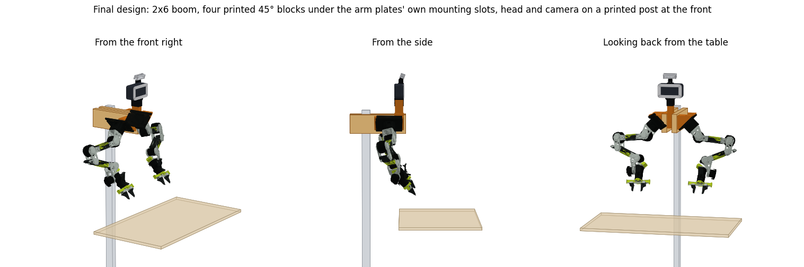
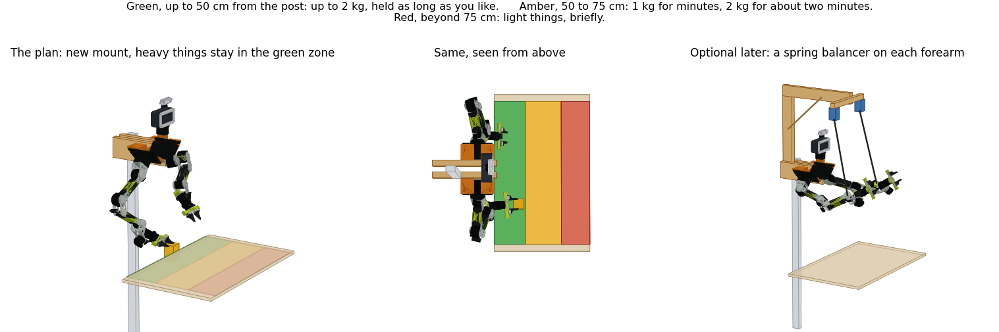
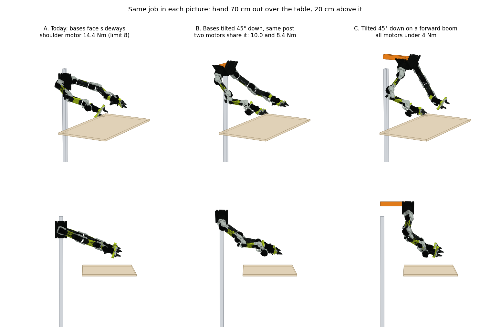
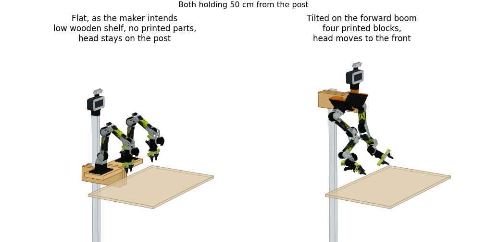

# Arm mount options

A replacement for the joint 1 counterbalance. Today each arm base faces sideways off the post, so joint 1 alone holds the whole arm whenever it reaches forward. The final design moves the shoulders forward over the work and tilts each base 45 degrees down so two motors share the load.

How to build it: [BUILD.md](BUILD.md).

## Result

Scored with the arm model in `rebot_teleop/kin.py`, which matched the real motors within 3% on 2026-11-11. Each mount was tried at 60 hand poses over the table (30 to 70 cm in front of the post, 10 to 40 cm to the side, 5 and 20 cm above the table, gripper pointing down and pointing forward). For each pose the lightest arm posture inside the Seeed joint limits was used. Joints 1 to 3 hold 8 Nm forever, 11 Nm for about 200 s and 15 Nm for about 35 s.

| Mount | Poses it reaches | Poses it holds forever | Holds forever with 0.5 kg in the hand | Worst motor load | Worst load with 0.5 kg |
|---|---|---|---|---|---|
| Today: bases face sideways on the post, shoulders 1.145 m | 70% | 23% | 13% | 14.9 Nm | 18.3 Nm |
| **Final: bases tilted 45 degrees down, boom 17.5 cm forward, shoulders 1.40 m, head on the boom nose** | 68% | 58% | 55% | 9.9 Nm | 11.8 Nm |
| Tilt only, no boom (shoulders 1.30 m) | 50% | 37% | 30% | 10.2 Nm | 12.7 Nm |
| Boom only, bases still sideways, 15 cm forward | 80% | 53% | 38% | 14.4 Nm | 17.1 Nm |
| Tilt and a 30 cm boom, ignoring the camera | 75% | 72% | 67% | 9.5 Nm | 11.0 Nm |

In the simulator the reach that failed on 2026-11-11 (hand 70 cm out, 20 cm above the table, held 15 s) needs 15.5 Nm on joint 1 today and 7.3 Nm with the final design.

## With an object in the hand

Same 60 hand poses, with a weight held at the gripper tip. "Shortest hold" is the worst reachable pose.

| Weight held | Today: poses held forever | Today: shortest hold | Today: worst motor load | Final: poses held forever | Final: shortest hold | Final: worst motor load | Final: worst wrist load (limit 5 Nm) |
|---|---|---|---|---|---|---|---|
| nothing | 14 | 37 s | 14.9 Nm | 35 | 329 s | 9.9 Nm | 1.4 Nm |
| 0.5 kg | 8 | 13 s | 18.3 Nm | 33 | 145 s | 11.8 Nm | 2.1 Nm |
| 1.0 kg | 3 | 8 s | 21.8 Nm | 28 | 66 s | 13.6 Nm | 3.0 Nm |
| 1.5 kg | 2 | 5 s | 25.2 Nm | 19 | 30 s | 15.4 Nm | 3.9 Nm |
| 2.0 kg | 0 | 2 s | 28.6 Nm | 14 | 15 s | 17.2 Nm | 4.8 Nm |

The heaviest object held forever, hand 15 cm above the table, best gripper angle:

| Hand distance from the post | Today | Final design |
|---|---|---|
| 35 cm | 1.0 kg | 2.0 kg |
| 50 cm | none (empty hand lasts 16 min) | 2.0 kg |
| 65 cm | none (empty hand lasts 81 s) | 0.5 kg (1 kg lasts 22 min, 2 kg lasts 139 s) |

The software enforces this once it knows the hand is loaded: `robot.payload(arm, kg)` sets the weight, or `robot.weigh(arm)` estimates it from the shoulder motors while the arm is still. A move or a teleop reach that the loaded arm could not hold for 60 s is then refused or stopped short, unless Heavy poses is on. Opening the gripper clears the weight. The right hand picture is an optional add on, not part of the build: a 2 kg spring balancer on each forearm makes even the fully straight reach hold forever with an empty hand and about 5.5 minutes with 1 kg.

Above about 2 kg the wrist motors become the limit, which no mount can change. Other tilts were tried again at 1 kg: 30 degrees puts 16.7 Nm on joint 1, 60 degrees puts 16.3 Nm on joint 2, hanging straight down puts 19 Nm on joint 2. 45 degrees stays the best split.

## Flat, the way the maker intends

Bases horizontal on a low shelf, joint 1 vertical. Best position found: base centre 20 cm forward of the post, 22 cm to the side, 80 cm above the floor (12 cm above the table).

| | Today | Flat on a low shelf | Low shelf, bases leaning 45 degrees outward | Tilted on the forward boom |
|---|---|---|---|---|
| Hand poses reached, of 60 | 42 | 51 | 42 | 41 |
| Held forever, empty hand | 14 | 34 | 37 | 35 |
| Held forever with 1 kg | 3 | 20 | 21 | 28 |
| Shortest hold with 1 kg | 8 s | 13 s | 65 s | 66 s |
| Worst motor load with 1 kg | 21.8 Nm | 18.3 Nm | 13.6 Nm | 13.6 Nm |
| Heaviest held forever at 35 cm | 1.0 kg | 1.0 kg | 2.5 kg | 2.0 kg |
| Heaviest held forever at 50 cm | none | 0.5 kg | 0.5 kg | 2.0 kg |
| Heaviest held forever at 65 cm | none | none | 0.5 kg | 0.5 kg |
| Printed parts | none | none | two 45 degree wedges | four blocks and a head post |
| Head and camera | stay | stay | stay | move to the boom |

Flat puts the whole load on joint 2 instead of joint 1, so it gains from position only, not from sharing. It is the easiest build and fine for light work within 40 cm. With 1 kg it cannot hold forever at 50 cm or beyond.

The operator chose the flat mount on 2026-11-12. The build, with a shelf 20 cm forward of the post made from two boards and four printed corner brackets, is in [BUILD_FLAT.md](BUILD_FLAT.md). A flat shelf level with the post scores no better than today.

## Why this shape

1. **Position matters most.** The shoulder load is the weight of the arm times how far forward its middle sits from the shoulder. Shoulders forward and about 72 cm above the table let the arm hang onto the work with a bent elbow.
2. **The tilt shares the load.** With the base sideways joint 1 takes everything. Tilted 45 degrees down, joint 1 and joint 2 each take about 70% of it.
3. **Upright or hanging straight down does not help.** It moves the whole load from joint 1 to joint 2, which is the same motor.
4. **The camera sets the boom length.** The boom hides the table from a camera on top of the post, so the head moves to the front of the boom. A camera on the head cannot see back under itself, so anything behind the head is blind. A longer boom only adds blind table, more tipping and more bend on the post. 17.5 cm puts the shoulders as far forward as the camera can still use.

## Not checked yet

1. The table is assumed 68 cm high with its near edge about 30 cm in front of the post. Neither is measured.
2. Arm against arm, arm against head and cable routing are not checked. Only the table, the post and the centre line are.
3. About a quarter of the lightest postures sit within 4 degrees of a joint limit (today 7%), so the software should pick postures with more margin.
4. The parts are sized from the arm and head CAD and the post size the operator confirmed. The few things CAD cannot tell are listed in [BUILD.md](BUILD.md).
5. The percentages come from random sampling of arm postures and move by about 5 points between runs.

Regenerate the numbers with `score_mounts.py` (`evaluate(mount)` then `summary(...)`).
